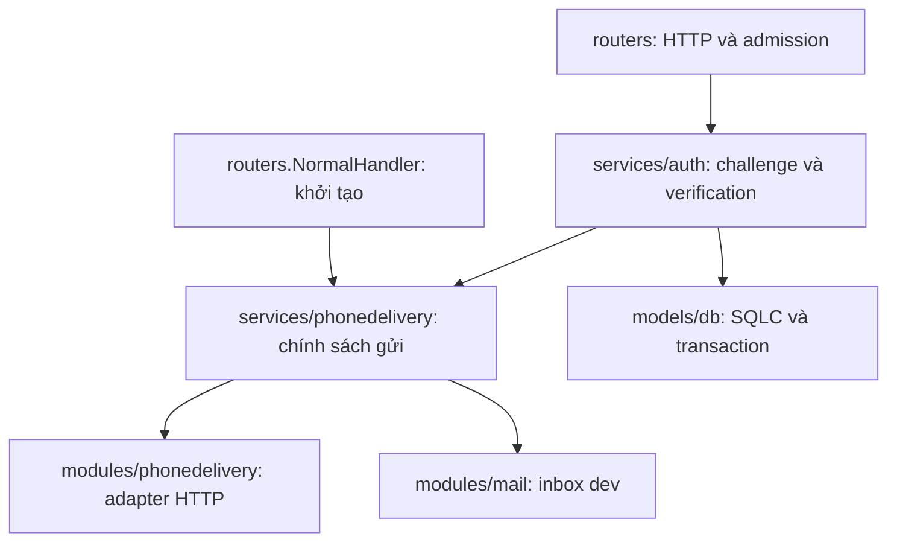

# Quyết định kiến trúc: gửi OTP qua số điện thoại

Phạm vi: luồng phone start/resend/link, các adapter SMS/Zalo/Telegram, cấu hình và điểm ghép HTTP. Đây không phải xác nhận toàn bộ IAM đã hoàn tất audit hay đạt chuẩn production.

## Vấn đề và quyết định

Bản đầu của tính năng đặt cả chọn kênh, đọc setting global, giới hạn gửi và log trong `modules/phonedelivery`. Điều này trộn điều phối ứng dụng với transport, lệch mô tả vai trò `modules` của repo. Chỉ thêm interface và chạy được test HTTP chưa đủ giải quyết vấn đề.

Giữ adapter giao thức trong `modules/phonedelivery`, chuyển chính sách sang `services/phonedelivery`. Interface nằm ở package tiêu thụ adapter. Các constructor adapter trả concrete type. Không tạo module Go mới/go.mod mới: thư mục `modules/` ở đây là quy ước tên package của repo.

| Tầng/file | Trách nhiệm | Không phụ trách |
| --- | --- | --- |
| `modules/setting/phone_delivery.go` | Đọc/kiểm tra INI và environment; chặn Mailpit production | Gửi tin hay tạo OTP |
| `routers/init.go:NormalHandler` | Khởi tạo service một lần, gắn vào pipeline HTTP | Thuật toán OTP |
| `routers/api/v1/auth/phone.go` | Bind input, browser cookie, rate limit dùng chung, ánh xạ HTTP/error | Gọi trực tiếp API nhà cung cấp |
| `services/auth/phone.go`, `contact_link.go` | Tạo/rotate/verify challenge, TTL, MAC, ràng buộc browser/session và DB transaction | Credentials hay JSON riêng của cổng |
| `services/phonedelivery/delivery.go` | Interface Sender, kênh được phép/default, factory, concurrency, log an toàn | Query DB, tạo tài khoản, quyết định OTP đúng/sai |
| `modules/phonedelivery/providers.go`, `http.go` | Mapping request/response Twilio, Zalo, Telegram; giới hạn response | Đọc cấu hình global, nghiệp vụ auth, rate limit theo danh tính |
| `models/db`, `db/query` | SQLC, persistence, locking và transaction hiện hữu | HTTP bên ngoài |

Luồng phụ thuộc chính:



Channel là đường vận chuyển, không phải danh tính hay một loại OTP mới. Vì vậy thay đổi này không tạo model/migration mới. Nếu sau này cần lịch sử giao tin, receipt, webhook hay đối soát chi phí, phải bổ sung persistence riêng có vòng đời rõ ràng.

## Căn cứ trong chính source hiện tại

- `services/jobs/verify_email.go` đã nhận hàm delivery từ ngoài khi khởi tạo handler; nghiệp vụ không cần tự quyết định SMTP.
- `routers.NormalHandler` đã tạo limiter và đưa vào HTTP pipeline bằng `modules/ipactive/context.go`. Delivery sử dụng cùng điểm ghép.
- Riêng `services/auth` nhận `*phonedelivery.Service` qua tham số hàm. Không gọi `FromContext` để tìm dependency ngầm ở tầng này.
- Cầu nối context chỉ phục vụ các HTTP handler dạng hàm đang có. Đây là lựa chọn tương thích repo, không phải khuyến nghị đặt mọi dependency vào context. Nếu đổi router sang handler struct sau này, có thể đưa service vào field.
- Các key `SMS_DESTINATION_*`, `SMS_GLOBAL_DAY`, `SMS_VERIFY_DESTINATION` giữ nguyên tên để tương thích, nhưng áp dụng chung cho cả ba kênh.
- README trước thay đổi còn nói không có Go tests/full login. Mô tả đó không phản ánh source hiện tại; đã cập nhật phần phạm vi và lệnh kiểm chứng.

## Nguồn cộng đồng và tài liệu chính thức

1. **Go Code Review Comments — Interfaces:** interface thường thuộc package sử dụng; phía triển khai trả concrete type. Áp dụng ở Sender của service và các constructor transport. Đây là hướng dẫn Go chính thức, không phải bằng chứng một implementation cụ thể không có bug. [Nguồn](https://go.dev/wiki/CodeReviewComments#interfaces)
2. **Go module layout:** Go mô tả nhiều cách tổ chức, có cơ chế `internal` để hạn chế import. Không có yêu cầu bắt buộc phải mang tên `modules/services/models/routers`. Giữ tên thư mục vì đó là cấu trúc hiện hữu của repo; kiểm soát hướng phụ thuộc quan trọng hơn đổi tên toàn source. [Nguồn](https://go.dev/doc/modules/layout)
3. **Gitea, ví dụ source cộng đồng cụ thể:** `services/mailer/mailer.go` có chọn sender SMTP/sendmail/dummy và khởi tạo queue; cấu hình mail ở `modules/setting/mailer.go`. Đây là ví dụ tách điều phối khỏi cấu hình/hạ tầng, không phải khuôn mẫu phải sao chép. Gitea đặt cả sender dưới services; vị trí adapter ở modules trong repo này là quyết định theo quy ước nội bộ. [Điều phối](https://github.com/go-gitea/gitea/blob/main/services/mailer/mailer.go), [cấu hình](https://github.com/go-gitea/gitea/blob/main/modules/setting/mailer.go)
4. **Zalo:** endpoint template qua số điện thoại, access_token header, template_data và tracking_id; phải kiểm tra error và msg_id, không chỉ HTTP 200. [API chính thức](https://docs.zaloplatforms.com/docs/ZBS/gui-tin-template-qua-sdt/api-gui-tin-qua-sdt/api-gui-tin)
5. **Telegram Gateway:** gửi verification code bằng phone_number/code, Bearer token, trả ok/result; khác Bot API với chat ID. [API chính thức](https://core.telegram.org/gateway/api)

Không có dữ liệu khảo sát để khẳng định “đa số dev Việt Nam dùng đúng cấu trúc này”. Khuyến nghị local Mailpit → test hợp đồng → staging cổng thật được đưa ra từ nhu cầu kiểm chứng của dự án.

## Bằng chứng có thể chạy lại

| Kiểm tra | Điều được kiểm chứng | Giới hạn |
| --- | --- | --- |
| `modules/phonedelivery/providers_test.go` | Mapping/auth/body/OTP có số 0 đầu, kiểm tra response thành công, JSON lỗi, 429/500, response quá lớn, không retry hay lộ raw error | HTTP giả lập, chưa có nhà cung cấp thật |
| `services/phonedelivery/delivery_test.go` | Default/disabled channel, snapshot cấu hình, guard production, input validation, không fallback ngầm, capacity chung và giải phóng sau cancel | Không thay thế kiểm thử tải nhiều replica |
| `services/phonedelivery/architecture_test.go` | Transport không import package ứng dụng; service delivery không import router/models/auth; auth không gọi thẳng transport | Guard phạm vi tính năng, không audit mọi package |
| `modules/setting/phone_delivery_test.go` | Cấu hình sai/thiếu credentials, production Mailpit, default/channel, tương thích SMS cũ | Không xác minh hiệu lực credentials trên cổng |
| `modules/log/manager_test.go`, `routers/request_log_test.go` | File không ANSI, metadata lỗi và request ID | Không lưu toàn bộ response body |
| `scripts/test-phone-delivery.py` | API thật với DB/Redis/Mailpit: ba kênh, mã sai, replay, cooldown đổi kênh, rotate mã, metadata log | Chỉ tới registration proof; chưa complete account hay link credential |
| `frontend/test/phone-delivery.test.js` | API helper giữ channel, cookie/header và mã lỗi phẳng | Không phải browser E2E/kiểm tra tương tác React |

Chạy từ root:

```sh
go test ./...
go vet ./...
make swagger-check
python3 scripts/test-phone-delivery.py
```

Frontend: `cd frontend && npm test && npm run build`.

Integration script dùng cổng tạm, tự dừng server, không chiếm 8080. Nó dùng DB/Redis local hiện có, không flush dữ liệu; các challenge có hạn và bốn tin Mailpit được giữ lại. Do dùng rate limit thật, chạy lặp quá nhiều trong một giờ có thể trả 429; khi đó chờ cửa sổ giới hạn hoặc dùng bộ DB/Redis test riêng.

## Những bảo đảm chưa có

- “Provider accepted” chưa đồng nghĩa người dùng nhận được OTP. Cần kiểm thử live với số do nhóm kiểm soát và webhook/receipt nếu muốn theo dõi delivery.
- Chưa tự refresh token Zalo, chưa ghi receipt bền vững hoặc đối soát billing.
- DB commit và gửi HTTP không atomic. Gửi thất bại có thể để lại challenge; resend đã rotate có thể làm mã cũ mất hiệu lực dù cổng gửi lỗi. Chính sách hiện tại trả 503 và cho yêu cầu mã mới sau cooldown, không hoàn tác dựa trên timeout không rõ kết quả. Outbox/idempotency là thay đổi thiết kế riêng nếu sản phẩm cần.
- Request timeout HTTP 5 giây, response tối đa 16 KiB, không follow redirect, capacity 4 mỗi instance là giá trị khởi đầu của dự án; chưa có benchmark chứng minh tối ưu.
- Test đã bổ sung không chứng minh mọi luồng IAM hiện hữu an toàn. Link phone, expiry theo thời gian, account completion và tải production cần bộ kiểm thử riêng đầy đủ.

Hướng dẫn cấu hình và nối từng cổng ở [phone-delivery.md](../phone-delivery.md).
