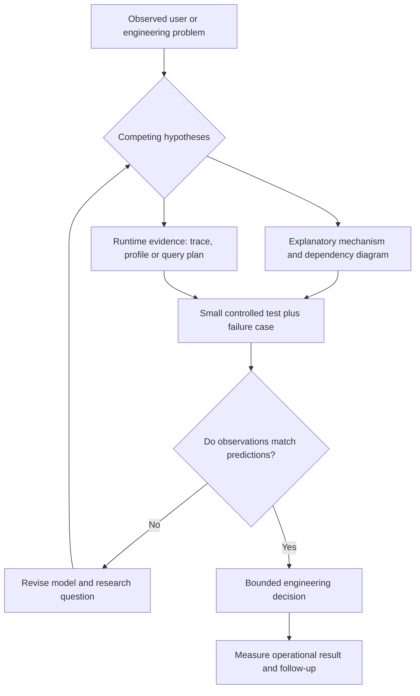

# Program 01 — Visual Reasoning and Real-World Evidence

**Status:** proposed, 2026-11-13. A diagram communicates a **model**; a photograph, trace, graph or screenshot may document an **observation**. Neither alone establishes causality or proves all runtime behavior. No diagrams in this file depict actual BDSPro production measurements.

## Why visual material is part of technical reasoning

Architecture charts, code maps, traces, query plans and engineering photographs can expose hidden relationships: execution order, state, ownership, bottlenecks, costs, users and operational failure. Use them to **ask and test questions**, not to decorate an argument. An impressive visual with unknown origin is weak evidence.

## Three classes and their limitations

| Class | Examples | What it can support | What it does NOT establish by itself |
|---|---|---|---|
| **Explanatory or proposed model** | C4 architecture diagram, call graph, dependency graph, sequence chart, state machine, failure tree | Claimed mechanisms and boundaries to inspect | Observed runtime behavior or performance |
| **Observed technical artifact** | Source/PR diff, trace waterfall, Go pprof flamegraph, PostgreSQL EXPLAIN output, CI logs, latency histogram | One sampled execution, change, data window or test under recorded conditions | Universal correctness, causality without controls, performance under other loads |
| **Real-world / cross-disciplinary image** | Photograph of a device, transport engineering diagram, factory process, field measurement | Physical constraints or an analogy that suggests mechanisms | Equivalence to software design, unverifiable performance or historical claims |

Label figures: **hypothetical**, **design-intent**, **source-derived at SHA**, **measured at date/environment**, or **external/unverified**. A "realistic" example is not the same as a real observed case.

## Provenance contract for each important figure

1. **Figure ID + question:** What claim is the image used to examine?
2. **Kind + evidence status:** diagram, actual screenshot, measured chart, field photo, third-party recreation?
3. **Origin:** original author/source URL and date, version/ref/SHA, redistribution license; user-owned/private material stays private unless expressly authorized.
4. **Context:** environment, build, workload, data size, configuration, acquisition or instrumentation method, sample/time window.
5. **Observed versus inferred:** distinguish visible data from assumptions and omitted branches; label units, error bars, estimated links and limitations.
6. **Reproduction:** raw trace/log/profile/SQL/test source, safe invocation command, comparator and observed result.
7. **Safety:** redact tokens, personal information, access credentials, private URLs and customer data before putting images or raw artifacts in a public repo.

Prefer editable text-based diagrams kept alongside a reproducible source and explanation. Do not copy third-party pictures into the repo without permission and an appropriate license.

## How visual models connect to observable evidence

**Illustration only** — no boxes above indicate experiments already performed.

## Example inquiry: a slow Go API request

- **Explain:** annotated sequence `HTTP → middleware → handler → SQLC → PostgreSQL → response`; mark presumed edges and possible lock/network time.
- **Observe:** measured p95/p99 latency (with workload and sample window), sampled request spans, Go pprof/trace, and a safely captured `EXPLAIN (ANALYZE, BUFFERS)` for the exact query/data context.
- **Compete:** expensive query vs CPU work vs lock contention vs network vs user-perceived relevance; select different measurements to distinguish them.
- **Intervene:** change one suspected cause at a time, compare against a baseline and include a failure-case/rollback check.
- **Report:** numbers and charts only if actually collected, with links to raw data and test commands; state remaining uncertainty.

## Original methodological sources

- [C4 model — Simon Brown](https://c4model.com/): distinct abstraction levels and diagrams for communicating architecture, not runtime proof.
- [Go diagnostics — official Go documentation](https://go.dev/doc/diagnostics): profiling, tracing, debugging, runtime stats and potential measurement overhead.
- [OpenTelemetry — traces](https://opentelemetry.io/docs/concepts/signals/traces/): spans, timing and context propagation; sampling and instrumented scope matter.
- [PostgreSQL 18 — Using EXPLAIN](https://www.postgresql.org/docs/18/using-explain.html): query plan, estimates and actual execution; statistics and workload affect results.

## Questions for every visual

- Is this an intended design, static source representation, one sampled execution or a deployed-system guarantee?
- Which edge is observed, which inferred, which metaphorical?
- What data/time/environment is missing? Could a different sample reverse the conclusion?
- Is the image's publication or redistribution authorized?
- Can another engineer trace the figure back to its author, SHA, SQL, profile or test?

**Rule:** Never say a diagram or synthetic metric was observed in BDSPro without a real, traceable artifact. Do not change code merely to make it resemble a picture.
